<p align="center">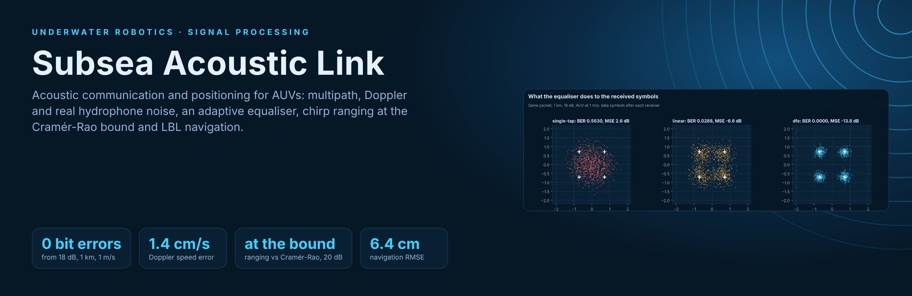</p>

<p align="center">
  <a href="https://github.com/kawtar-bellamine/subsea-acoustic-link/actions/workflows/tests.yml"></a>
  
  
  
  
</p>

**Acoustic communication and positioning for underwater robots, from the physics of the channel to the navigation
filter.** Under water there is no GPS and no radio: an AUV talks and locates itself with sound, through a channel full
of echoes, Doppler and noise. This project simulates that channel, builds the signal processing that makes a link and a
position fix work in it, measures every algorithm against a baseline or a theoretical bound, and tests the receiver
with a **real hydrophone recording**.

<p align="center">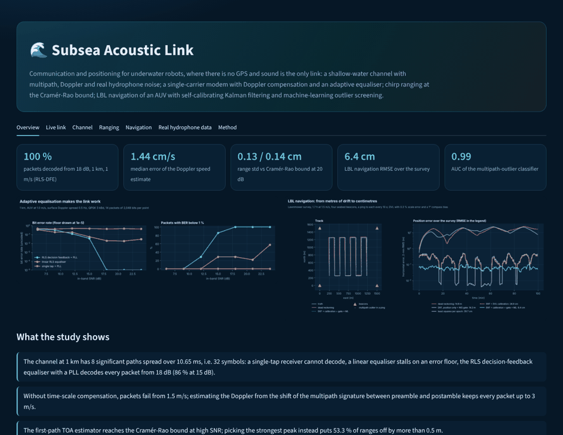</p>

## Results at a glance

| Question | Answer |
|---|---|
| How bad is the channel? | At 1 km in 50 m of water, **8 eigenrays over 10.7 ms**, i.e. 32 symbols of intersymbol interference at 3 kBd. |
| Does the modem decode? | An RLS **decision-feedback equaliser with a PLL** decodes **every packet from 18 dB** (0 bit errors over 14 packets per point) and 86 % at 15 dB. A linear equaliser stalls on a 2 % error floor; a single tap never decodes. |
| What does Doppler cost? | Without time-scale compensation, packets fail from 1.5 m/s. Estimated from the preamble-postamble shift (**median error 1.4 cm/s**) and resampled, every packet passes up to 3 m/s. |
| How precise is ranging? | The first-path time-of-arrival estimator **reaches the Cramér-Rao bound** (0.13 cm measured vs 0.14 cm bound at 20 dB, one leg). Picking the strongest peak instead puts **53 %** of ranges off by more than 0.5 m. |
| Can ML spot bad ranges? | A LightGBM model on 8 matched-filter features flags multipath outliers with **AUC 0.995** (recall 90 %, precision 97 %) on unseen pings. |
| How well does the AUV navigate? | Dead reckoning drifts to **14.8 m** RMSE. An EKF that estimates the **compass bias and DVL scale** with χ² gating reaches **6.3 cm** RMSE and recovers the 1° compass bias (0.98°). |
| Is real noise different? | The Glacier Bay recording has a band kurtosis of **8.6** (Gaussian: 3), yet at equal in-band SNR the link performs the same as with Gaussian noise. |

## 1. The channel

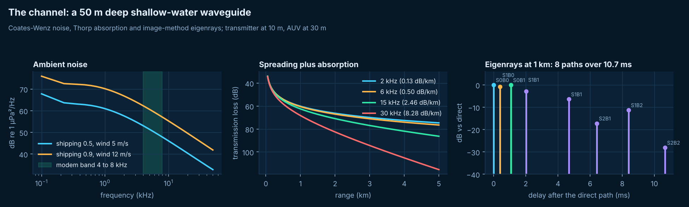

`sal/environment.py`: sound speed from Mackenzie (1981, checked against its published value), Thorp absorption,
Coates fit of the Wenz ambient-noise curves, eigenrays of an isovelocity waveguide by the image method, with Rayleigh
roughness loss at the surface and the Rayleigh reflection coefficient of a sand bottom. `sal/channel.py` applies them
to a waveform in complex baseband: one delayed and scaled copy per ray, a time compression `a = v/c` for the closing
speed, a carrier rotation `fc·a`, and a random Doppler spread on the rays that touched the moving surface.

## 2. The modem: synchronisation, Doppler, equalisation

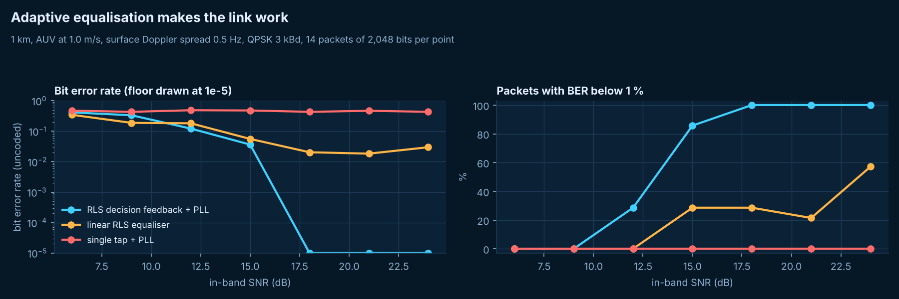

`sal/phy.py` and `sal/receiver.py`. QPSK at 3 kBd in the 4 to 8 kHz band, root-raised-cosine pulse, 50 ms LFM chirps
before and after the packet.

1. **Detection** with a normalised chirp matched filter (threshold 0.3, no false alarm in 300 noise-only trials).
2. **Doppler estimation** from the preamble-postamble interval. The interval is measured by cross-correlating the two
   whole multipath signatures, because fading can swap the strongest path between the two chirps: estimating from
   two single peaks gave errors of 3 m/s on a still vehicle.
3. **Resampling** by `1/(1 + â)` and removal of the residual carrier rotation.
4. **Timing on the first significant path**, not the strongest one.
5. **Fractionally spaced RLS equaliser with a second-order PLL** (Stojanovic, Catipovic and Proakis): single tap,
   linear, or decision feedback.

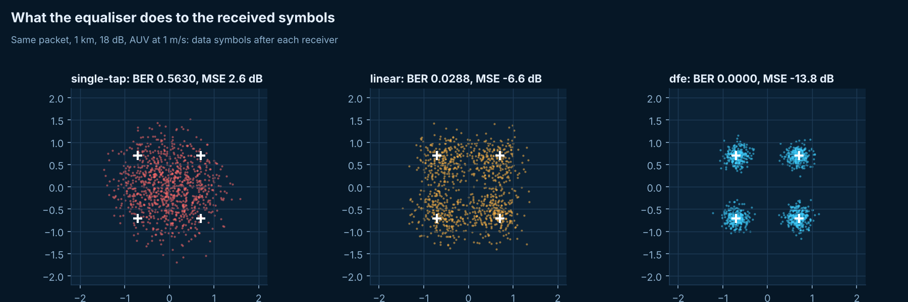

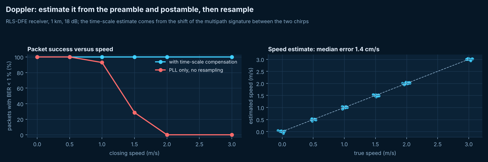

## 3. Real hydrophone data

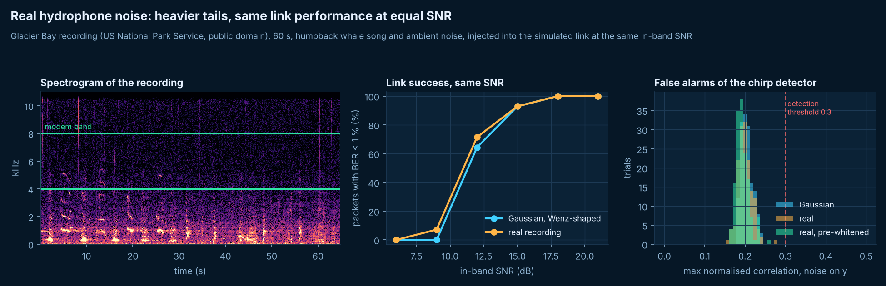

The receiver is tested with a 60 s recording from a hydrophone in Glacier Bay, Alaska (humpback whale song and ambient
noise, US National Park Service, public domain), taken through the same front end and scaled to the same in-band SNR
as the synthetic noise. The recording is heavy-tailed (kurtosis 8.6 in the band), but the 50 ms chirp and the equaliser
average over thousands of samples: the packet success curve is the same as with Gaussian noise. The detector shows the
other side: pre-whitening removes most of the false alarms of coloured Gaussian noise at a low threshold (58 % to 12 %)
but fewer with the real recording (43 % to 28 %), whose whale song is structured, not just coloured.

## 4. Ranging

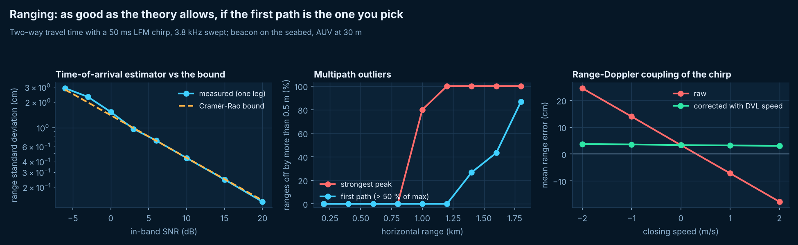

`sal/ranging.py`. Two-way travel time with a known turnaround; sub-sample time of arrival by parabolic interpolation.

* **Against the bound:** the measured standard deviation follows the Cramér-Rao bound `1 / (8π² β² E/N0)` computed
  from the chirp's RMS bandwidth, from -6 to 20 dB.
* **Multipath:** beyond 1 km the surface and bottom echoes outgrow the direct path; the strongest-peak estimator jumps
  to them, the first-path estimator has no outlier up to 1.2 km.
* **Range-Doppler coupling:** an LFM up-chirp received with compression `a` arrives early by `a (fc T/B + T/2)`. The
  formula matches the measurement within 1 µs (a test checks it); corrected with the DVL speed, the bias at 2 m/s drops
  from 17.8 cm to 3 cm.

## 5. Machine learning on the matched filter

`sal/outliers.py`. 1,600 simulated pings (ranges 200 m to 1.9 km, speeds ±2 m/s, source levels 158 to 172 dB, both
noise types) train a LightGBM classifier; 800 others with different seeds test it. Features come from the correlation
output only: peak, number of peaks above half the maximum, delay and ratio between first and strongest peak, second
peak, peak-to-median, SNR. **AUC 0.995**, recall 90 %, precision 97 %.

## 6. LBL navigation

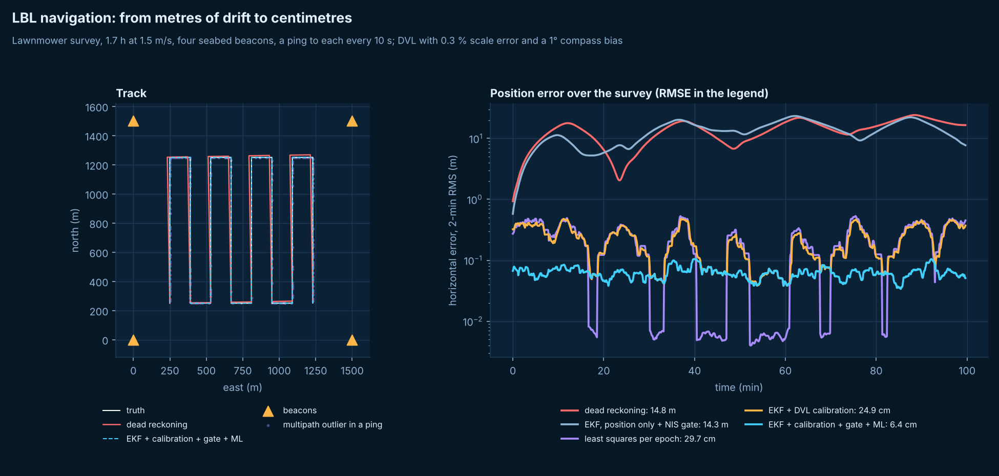

`sal/positioning.py`. Four seabed beacons on a 1.5 km square, AUV at 30 m on a 1.7 h lawnmower survey, a ping to each
beacon every 10 s (2,392 pings, 7.4 % multipath outliers). DVL with 0.3 % scale error, compass with a 1° bias.

| Estimator | RMSE | 95th percentile | Notes |
|---|---:|---:|---|
| Dead reckoning | 14.8 m | 22.2 m | drift from the compass bias and DVL scale |
| Least squares per epoch | 29.7 cm | 71 cm | no memory, no outlier handling |
| EKF on position only | 54.9 cm | 88 cm | treats the DVL bias as noise |
| EKF on position only + χ² gate | 14.3 m | 22.1 m | **locks itself out**: rejects 1,850 good ranges |
| EKF with heading-bias and scale states | 24.9 cm | 55 cm | learns the DVL calibration |
| **+ χ² gate** | **6.3 cm** | **12.6 cm** | rejects exactly the 176 outliers, nothing else; compass bias found: 0.98° |
| + gate + ML screening | 6.4 cm | 12.6 cm | ML removes 165 outliers before the filter, the gate catches the last 11 |

The lesson: an outlier gate is only as good as the filter's model of its own errors. With the calibration states the
gate alone is enough here; the ML screen does the same job from the signal alone, which matters before the filter has
converged or when there is no filter.

## Interactive lab

```bash
pip install -r requirements.txt
python experiments/run_all.py     # full study, about 4 minutes, writes results/
streamlit run app/dashboard.py    # dashboard
pytest -q                         # 18 tests, about 40 seconds
```

The **Live link** tab sends a packet through the simulated ocean with your range, speed, SNR, surface roughness, noise
(synthetic or the real recording) and receiver, and shows the impulse response, the chirp correlation, the
constellation and the equaliser learning curve. The **Channel** tab recomputes the eigenrays when you change depth,
temperature, salinity or sea state.

<table>
<tr><td width="50%">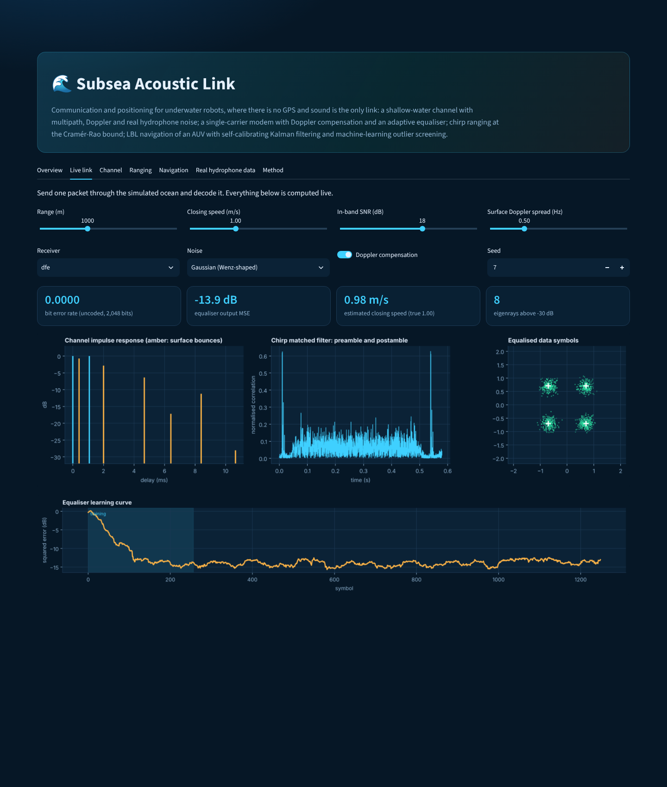</td>
<td width="50%">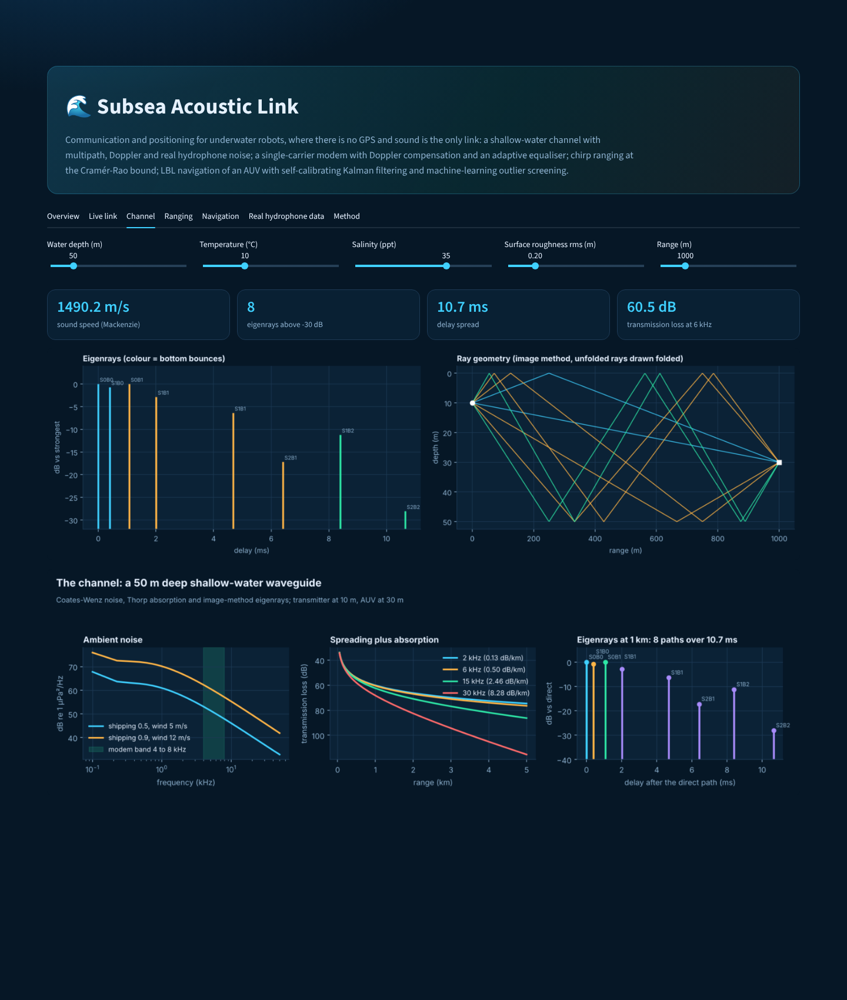</td></tr>
<tr><td>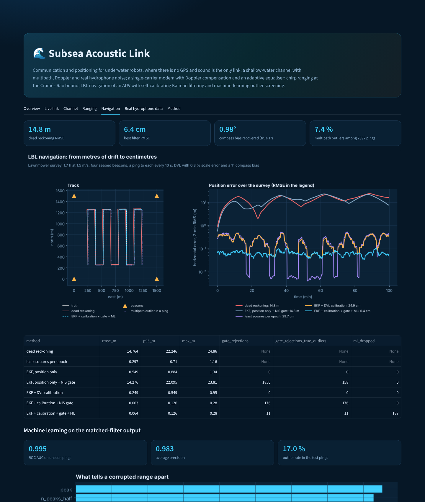</td>
<td>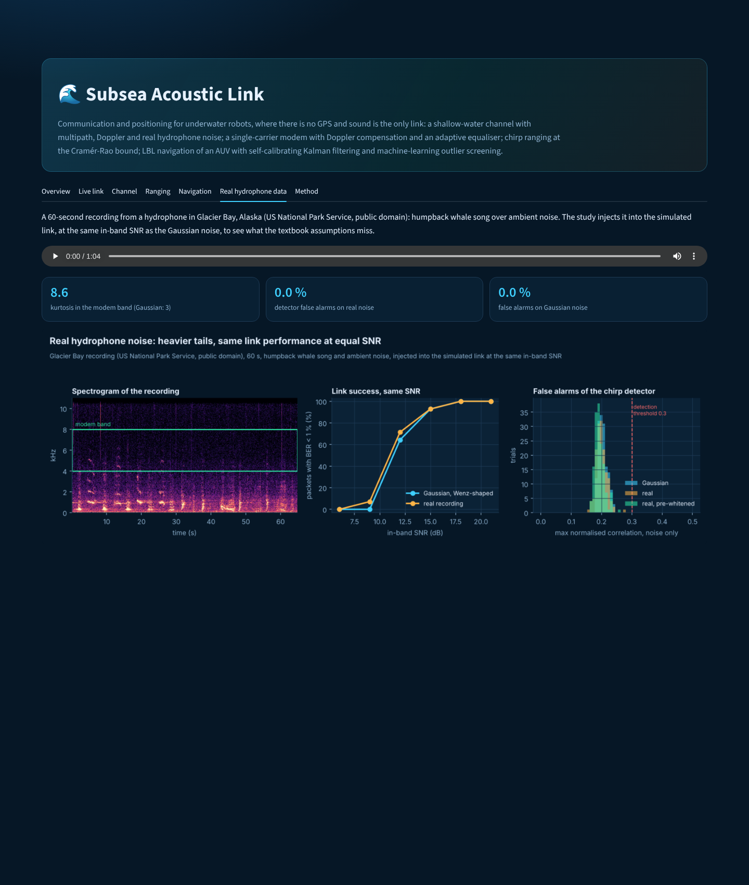</td></tr>
</table>

## Repository map

```
sal/environment.py   sound speed, absorption, ambient noise, eigenrays (image method)
sal/channel.py       time-varying multipath channel with Doppler; synthetic and real noise
sal/phy.py           chirps, RRC pulse, QPSK packet, matched filter, whitening, resampling
sal/receiver.py      detection, Doppler estimation, timing, RLS equalisers with PLL
sal/ranging.py       two-way travel time, Doppler bias correction, Cramér-Rao bound
sal/outliers.py      LightGBM outlier model on matched-filter features
sal/positioning.py   lawnmower survey, DVL model, least squares, EKF with calibration states and gating
experiments/         full study (run_all.py) and figures
app/dashboard.py     Streamlit lab
tools/               figure redraw, screenshots, banner, tour GIF
data/real/           Glacier Bay hydrophone recording (public domain) and its attribution
```

## Limits

* **Simulation first.** The only real data is the hydrophone recording used as noise; the next step is to run the
  receiver on sea-trial recordings of known packets and compare simulated and measured performance.
* Isovelocity waveguide with a flat bottom: a real sound-speed profile refracts rays and would need a ray tracer
  (Bellhop).
* Uncoded BER: channel coding would trade rate for a much lower packet error rate.
* Simple surface Doppler model; beacon positions and sound speed are assumed known in the navigation scenario.

## Data and licence

Hydrophone recording: Chris Gabriele, Glacier Bay National Park and Preserve, US National Park Service (2020), public
domain, via the librosa example data (CC-PDM-1.0); SHA-256 checked. Code: MIT.
